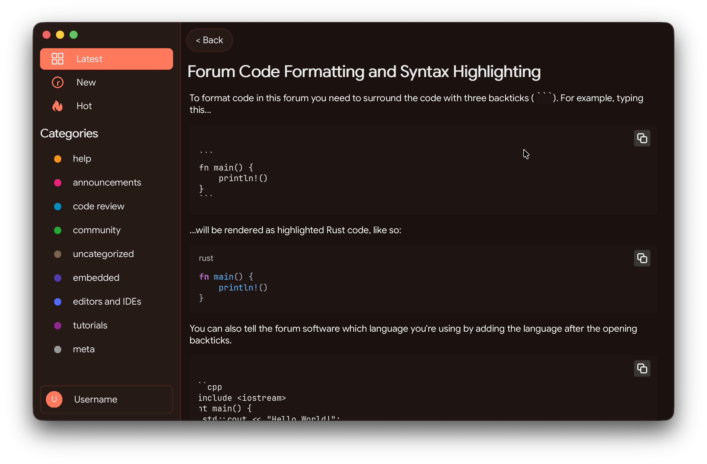

# RustForum

The RustForum client implementation using Rust + Aimer



# How to run it ?

## Optiion 1: Using Cargo

```bash
  cargo run  # maybe the asset files is not load properly
```

## Optiion 2: Using Aimer CLI : build > assemble > run

### install CLI

```
cargo install --git https://github.com/Cottons29/aimer.git aimer_cli --branch 1.97.1-alpha-3
```

### run !!!

```
aimer run 
```

